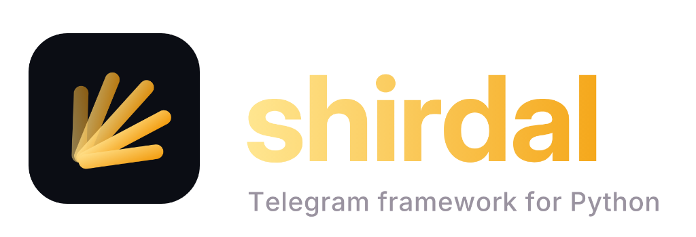

<div align="center" dir="rtl">



# Shirdal (شیر‌دال)

**فریم‌ورک سریع، ماژولار و Context-First پایتون برای تلگرام — مجهز به موتور داخلی Bot API 10.5 و هستهٔ بومی MTProto 2.0**

[English](README.md) | **فارسی**

[](https://www.python.org/downloads/)
[](https://pypi.org/project/shirdal/)
[](https://github.com/Vicious-Cycle/shirdal/actions/workflows/ci.yml)
[](LICENSE)

</div>

---

<div dir="rtl">

شیر‌دال منطق ربات (`Dispatcher`، `Context`، فیلترها، `FSM`، ضدبلاک، پلاگین‌های زنده و ذخیره‌سازی) را پشت پروتکل `TransportAdapter` از لایهٔ شبکه جدا می‌کند. نتیجه یک معماری واحد است که هم با **موتور داخلی Bot API 10.5** (بدون نیاز به کتابخانهٔ HTTP خارجی) کار می‌کند و هم **هستهٔ بومی ۵ لایه‌ای MTProto 2.0** را در دل خود دارد.

## معماری سیستم

```text
  هندلرها و پلاگین‌های شما (Context، فیلترها، FSM، Scheduler، MultiBot)
                                │
                        TransportAdapter
         ┌──────────────────────┼──────────────────────┐
         ▼                      ▼                      ▼
   BotAPIAdapter      NativeMTProtoAdapter    Telethon / Hydrogram / Mock
 (HTTP Keep-Alive +   (TL Codec, AES-256-IGE,   (رپرهای MTProto و آداپتور
  WebhookServer)       TCP Abridged, PeerCache)  تست آفلاین)
```

## چرا Shirdal؟

- **موتور داخلی Bot API (`BotAPIAdapter`):** کلاینت Keep-Alive بدون نیاز به `aiohttp` یا `httpx`، با پشتیبانی اختیاری از `msgspec` و سرور `WebhookServer` داخلی روی `asyncio`.
- **پشتیبانی کامل از Bot API 9.4 تا 10.5:** دکمه‌های رنگی (`ButtonStyle`: `primary`، `success`، `danger`)، ایموجی پرمیوم (`icon` و `custom_emoji()`)، دکمهٔ غیرفعال (`disabled`)، زمان محلی (`date_time()`)، پاسخ مخفی گروه (`ctx.reply_ephemeral()`)، استریم زندهٔ متن (`ctx.stream()`)، پیام‌های ساختاریافتهٔ `Rich Messages` (`ctx.reply_rich()` و `ctx.stream_rich()`)، تگ اعضا (`ctx.set_member_tag()`)، تاپیک در پیوی و `set_my_settings()`.
- **هستهٔ بومی ۵ لایه‌ای MTProto 2.0 (`shirdal.mtproto` و `NativeMTProtoAdapter`):**
  - کدک باینری Zero-Copy (`TLReader`/`TLWriter`) + کدجنراتور خودکار `.tl` به `@dataclass(slots=True)`.
  - رمزنگاری `AES-256-IGE`، استخراج کلید MTProto 2.0، `AuthKey`، تجزیهٔ Pollard's rho و `HandshakeSession` سه مرحله‌ای.
  - ترنسپورت `TCPAbridgedTransport`، سشن SQLite (`MTProtoSessionState`) و `MTProtoWire` (`msg_container`، `msgs_ack`، `bad_server_salt`، `gzip_packed`، `rpc_result`).
  - کش دائمی `PeerCache` (حافظه + SQLite)، ردیاب گپ آپدیت‌ها (`UpdateStateTracker`) و آپلود/دانلود موازی `FileTransferManager`.
- **آماده برای محیط واقعی:** محافظ ضدبلاک `AntiFloodAdapter`، پلاگین‌های Hot-Reload، `SQLiteStorage` (حالت WAL + کش L1)، `RedisStorage`، `MySQLStorage`، `EncryptedStorage`، `MultiBot` و CLI کامل (`shirdal new`، `shirdal doctor`، `shirdal run`).

## نصب

```bash
pip install shirdal              # نصب کامل همراه با Bot API 10.5 و Native MTProto 2.0

# افزونه‌های اختیاری
pip install "shirdal[fast]"      # بهینه‌سازی سرعت با uvloop و msgspec
pip install "shirdal[telethon]"  # آداپتر Telethon
pip install "shirdal[redis]"     # ذخیره‌ساز Redis
```

## شروع سریع: Bot API 10.5

```python
import os
from shirdal import (
    BotAPIAdapter,
    ButtonStyle,
    Context,
    Shirdal,
    button,
    callback,
    command,
    custom_emoji,
    incoming,
    inline_keyboard,
)

bot = Shirdal(BotAPIAdapter(os.environ["BOT_TOKEN"]))

@bot.on(incoming & command("start", prefix="/"))
async def start(ctx: Context) -> None:
    badge = custom_emoji("5368324170671202286", "✨")
    kb = inline_keyboard([
        [
            button("تأیید", "act:ok", style=ButtonStyle.SUCCESS, icon="5368324170671202286"),
            button("رد", "act:no", style=ButtonStyle.DANGER),
        ]
    ])
    await ctx.reply(f"{badge} <b>یک گزینه را انتخاب کنید:</b>", reply_markup=kb)

@bot.on_callback(callback(prefix="act:"))
async def on_action(ctx: Context) -> None:
    await ctx.answer("ثبت شد")
    await ctx.reply_ephemeral(f"عملیات: <code>{ctx.callback_data}</code>")

if __name__ == "__main__":
    bot.run()
```

## شروع سریع: Native MTProto 2.0

```python
import os
from shirdal import Context, DeviceProfile, NativeMTProtoAdapter, Shirdal, command, outgoing

adapter = NativeMTProtoAdapter(
    int(os.environ["API_ID"]),
    os.environ["API_HASH"],
    session_path="account.sqlite",
    device=DeviceProfile.desktop(),
)

bot = Shirdal(adapter, plugins_dir="plugins", hot_reload=True)

@bot.on(command("ping") & outgoing)
async def ping(ctx: Context) -> None:
    await ctx.edit("Pong from Native MTProto 2.0", auto_delete=10)

if __name__ == "__main__":
    bot.run()
```

## مستندات

- [راهنمای کامل فارسی](docs/fa/README.md)
- [شروع سریع و CLI](docs/getting-started.md)
- [قابلیت‌های Bot API 10.5](docs/bot-api.md)
- [راهنمای Rich Messages](docs/rich-messages.md)
- [معماری هستهٔ بومی MTProto 2.0](docs/native-mtproto.md)
- [سرور Webhook و استقرار](docs/webhook-and-deployment.md)

## اجرای تست‌ها

```bash
PYTHONPATH=src python3 -m unittest discover -s tests -v
```

</div>
